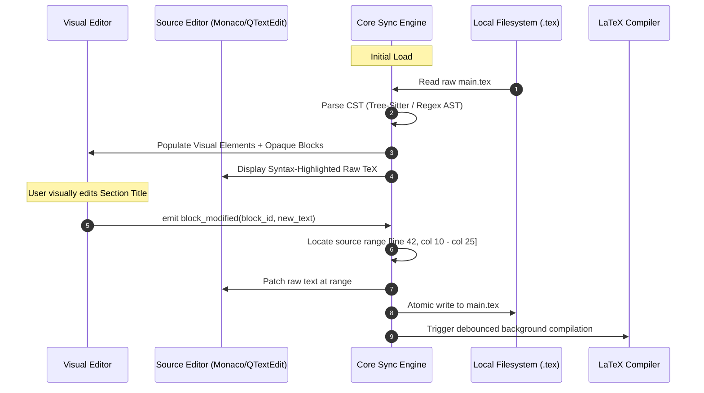

# SYSTEM ARCHITECTURE SPECIFICATION
## ResearchIDE: Modular Architecture for Academic Writing & Local AI
**Document Version:** 1.0.0  
**Framework:** Python 3.11+ / PySide6  
**Target OS:** Windows 10/11  
**Target Hardware:** AMD Ryzen 5 5600G (6C/12T) | NVIDIA RTX 3060 12GB | 16 GB RAM  

---

## 1. System Overview & Architectural Topology

ResearchIDE utilizes a **layered, decoupled desktop architecture** implemented in Python 3.11 with PySide6 (Qt 6.7+). The architecture emphasizes high modularity, strict process boundary isolation, and a single source of truth for documents.

```mermaid
flowchart TB
    subgraph UI_Layer ["Desktop Presentation Layer (PySide6)"]
        MainWindow["MainWindow & Ribbon Toolbar"]
        DockManager["Dockable Panel Manager"]
        VisualEditorWidget["Visual Editor Canvas (QWebEngine / TipTap)"]
        SourceEditorWidget["LaTeX Source Editor (QPlainTextEdit / QSyntaxHighlighter)"]
        PDFViewerWidget["PDF Preview Canvas (QWebEngine / PDF.js)"]
        AIWidget["AI Research Assistant Panel"]
        ProjectExplorer["Project Tree & Document Explorer"]
    end

    subgraph Core_Layer ["Application Core & Synchronization Engine"]
        DocManager["Document Lifecycle Manager"]
        CanonicalDoc["Canonical Document Model (AST/CST)"]
        SyncEngine["Bidirectional Document Synchronizer"]
        SourceMapper["Two-Way Position & SyncTeX Mapper"]
        EventBus["Internal Qt Signal / Event Bus"]
    end

    subgraph Service_Layer ["Specialized Engine Services"]
        LaTeXService["LaTeX Daemon (MiKTeX/TeX Live Runner)"]
        AIService["Ollama Gateway (HTTP Streaming Client)"]
        LiteratureService["PDF Text/Metadata & Reference Extractor"]
        SymPyService["SymPy Math Verification Engine"]
        TemplateService["Publication Template & Compliance Engine"]
    end

    subgraph Storage_Layer ["Persistence & File Subsystem"]
        ProjectDB["SQLite Database (.researchide/project.db)"]
        FileStore["Project Directory Structure"]
        SnapshotEngine["Pre-Action Snapshot & Rollback Storage"]
    end

    UI_Layer <--> Core_Layer
    Core_Layer <--> Service_Layer
    Service_Layer <--> Storage_Layer
    Core_Layer <--> Storage_Layer
```

---

## 2. Subsystem Breakdown

### 2.1 Desktop Application Layer (PySide6)
- **Main Window & Ribbon:** Implemented via custom PySide6 widgets providing an Office-inspired multi-tab Ribbon (Home, Insert, Layout, References, Review, View, AI).
- **Workspace & Docking:** Multi-document tabs with flexible split-screen docking (allowing Side-by-Side Visual Editor, LaTeX Source, and PDF Preview).
- **Dialog & Notifications:** Asynchronous non-blocking Qt notification toasts and modal dialogs for settings, project creation, and template management.

### 2.2 Canonical Document Engine
- **Semantic Model:** An object-oriented Abstract Semantic Tree representing standard academic elements:
  - `Document`: Root container with metadata, preamble config, and block sequence.
  - `SectionBlock`: Hierarchical headings (Part, Chapter, Section, Subsection).
  - `ParagraphBlock`: Rich text runs (bold, italic, code, links).
  - `EquationBlock`: Display and inline math with LaTeX syntax and SymPy verification badges.
  - `TableBlock`: Structured grid with captions, alignments, and booktabs styling.
  - `FigureBlock`: Path to graphic, caption, label, width, and placement specifiers.
  - `CitationInline`: Citation keys linking to the bibliography.
  - `OpaqueLaTeXBlock`: Unparsed raw LaTeX sequences (custom macros, TikZ diagrams, complex packages).
- **Dual Representation & Source Mapping:** Every node in the semantic model retains its byte and line/column source coordinates in the raw `.tex` file.

### 2.3 LaTeX Compilation Engine
- **Toolchain Supervisor:** Automatically detects MiKTeX or TeX Live in Windows environment paths or standard installation directories (e.g., `E:\miktex\miktex\bin\x64\`).
- **Engines Supported:** PDFLaTeX, XeLaTeX, LuaLaTeX, BibTeX, Biber.
- **Asynchronous Execution:** Compilations run in background `QThread` / `QProcess` workers with stdout/stderr stream parsing into structured JSON diagnostics.
- **SyncTeX Integration:** Coordinates bidirectional mapping between PDF canvas positions and LaTeX source code line numbers.

### 2.4 Local AI Subsystem (Ollama)
- **Local HTTP Gateway:** Communicates asynchronously with Ollama (`http://localhost:11434`) using `httpx` or Qt Network requests.
- **Single-Model Policy:** Manages model lifecycle so that only one model resides in VRAM at any time (e.g., `Qwen2.5-14B-Instruct-Q4_K_M`).
- **Virtual Personas:** Provides distinct research roles (Academic Writer, Proofreader, LaTeX Engineer, Math Verifier) using specialized system prompts and JSON schemas.
- **Context Isolation:** AI memory and retrieval contexts are strictly scoped to the active project's directory and `.researchide/project.db`.

### 2.5 Research & Literature Subsystem
- **PDF Extraction:** Extracts text, headings, two-column layouts, and bibliographic references using `pypdf` and native PDFium.
- **Traceability:** Every extracted claim stores the originating document hash, page number, and text snippet.
- **Reference Management:** Full BibTeX/RIS parsing, validation, and citation auto-completion.

### 2.6 Storage & Persistence Subsystem
- **Project SQLite Database:** Stores project metadata, document structural blocks, references, extracted claims, and full-text search indexes (`FTS5`).
- **Safe Atomic Saving:** Writes files to temporary swap files before atomic rename, preventing file corruption during crashes.
- **Pre-Action Snapshot Engine:** Creates zstd-compressed backups of project files before any AI-assisted modification.

### 2.7 Publication & Template Subsystem
- **Template Library:** Built-in profiles for IEEE, Springer Nature, Elsevier, ACM, and generic academic styles.
- **Compliance Auditor:** Validates page limits, margin specs, abstract length, and caption presence before final export.

---

## 3. Document Synchronization Architecture

The central architectural challenge is preserving arbitrary LaTeX source while offering visual editing. 

### Fallback for Unsupported Constructs
When the parser encounters constructs beyond standard semantic nodes (e.g., `\newcommand`, `\begin{tikzpicture}`, `\usepackage`, raw `\def` primitives):
1. The engine constructs an `OpaqueLaTeXBlock`.
2. In the visual editor, the block is rendered as an interactive, protected "LaTeX Code Pill" showing a preview or code snippet.
3. The visual editor is prohibited from altering the internal tokens of opaque blocks.
4. When writing back to disk, the raw byte slice of the opaque block is preserved with 100% fidelity.

---

## 4. Hardware Optimization Policies

- **16 GB RAM Conservation:**  
  - PySide6 application base footprint: ~150–250 MB.
  - SQLite in-process storage: ~50 MB.
  - Background indexing throttled to single worker thread to maintain system responsiveness.
- **RTX 3060 12 GB VRAM Budget:**  
  - Working allocation capped at 9.5 GB.
  - Primary resident model: 14B Q4_K_M (~8.6 GB) + 8k context KV cache (~900 MB).
  - Unloading signal issued if external 3D/CUDA tasks request memory.

