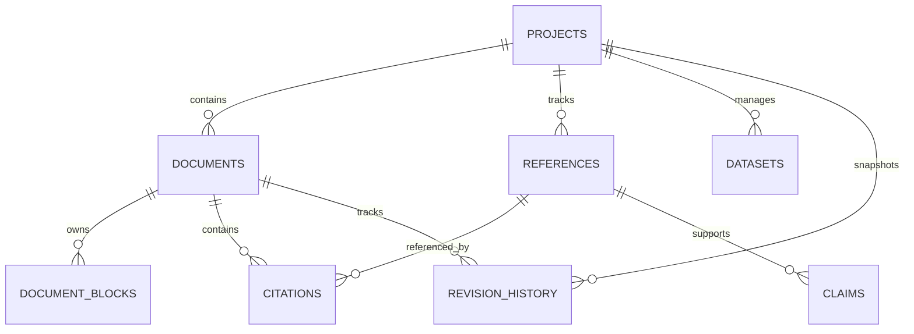

# DATABASE DESIGN SPECIFICATION
## ResearchIDE: SQLite Project & Global Storage Architecture
**Document Version:** 1.0.0  
**Database Engine:** SQLite 3 (WAL Mode Enabled)  
**ORM / Data Access:** Python standard `sqlite3` + typed repository patterns (`dataclasses`)  

---

## 1. Storage Topology & Scope

ResearchIDE employs a **hybrid storage model**:
1. **Global Application Database (`~/.researchide/global.db`):** Stores user settings, recently opened projects, global template metadata, and AI model configurations.
2. **Project Database (`{ProjectRoot}/.researchide/project.db`):** Self-contained, portable database specific to each research project storing document structure, literature references, extracted claims, search indexes, and revision metadata.

---

## 2. Project Database Schema (`project.db`)

### 2.1 Entity Relationship Diagram



### 2.2 DDL Specifications

```sql
PRAGMA journal_mode = WAL;
PRAGMA foreign_keys = ON;

-- 1. Project Information
CREATE TABLE IF NOT EXISTS project_info (
    id TEXT PRIMARY KEY,
    name TEXT NOT NULL,
    created_at TIMESTAMP DEFAULT CURRENT_TIMESTAMP,
    updated_at TIMESTAMP DEFAULT CURRENT_TIMESTAMP,
    description TEXT,
    active_compiler TEXT DEFAULT 'pdflatex',
    active_template TEXT
);

-- 2. Documents within Project
CREATE TABLE IF NOT EXISTS documents (
    id TEXT PRIMARY KEY,
    relative_path TEXT NOT NULL UNIQUE,
    title TEXT NOT NULL,
    doc_type TEXT NOT NULL CHECK(doc_type IN ('master_tex', 'section_tex', 'bib', 'notes', 'markdown')),
    content_hash TEXT NOT NULL,
    created_at TIMESTAMP DEFAULT CURRENT_TIMESTAMP,
    updated_at TIMESTAMP DEFAULT CURRENT_TIMESTAMP
);

-- 3. Document Canonical Blocks (Visual & Source Synchronization)
CREATE TABLE IF NOT EXISTS document_blocks (
    id TEXT PRIMARY KEY,
    document_id TEXT NOT NULL REFERENCES documents(id) ON DELETE CASCADE,
    block_type TEXT NOT NULL CHECK(block_type IN ('heading', 'paragraph', 'equation', 'figure', 'table', 'opaque_latex')),
    ordinal INTEGER NOT NULL,
    raw_latex TEXT NOT NULL,
    source_start_line INTEGER NOT NULL,
    source_start_col INTEGER NOT NULL,
    source_end_line INTEGER NOT NULL,
    source_end_col INTEGER NOT NULL,
    metadata_json TEXT
);
CREATE INDEX IF NOT EXISTS idx_doc_blocks_ordinal ON document_blocks(document_id, ordinal);

-- 4. References and Literature Bibliography
CREATE TABLE IF NOT EXISTS literature_references (
    id TEXT PRIMARY KEY,
    cite_key TEXT UNIQUE NOT NULL,
    entry_type TEXT NOT NULL, -- 'article', 'inproceedings', 'book', etc.
    title TEXT NOT NULL,
    authors TEXT NOT NULL, -- JSON array of author strings
    year INTEGER,
    journal TEXT,
    doi TEXT,
    abstract TEXT,
    bibtex_raw TEXT NOT NULL,
    pdf_path TEXT, -- relative path to literature/
    is_verified INTEGER DEFAULT 0
);
CREATE INDEX IF NOT EXISTS idx_refs_cite_key ON literature_references(cite_key);

-- 5. In-Text Citations
CREATE TABLE IF NOT EXISTS citations (
    id TEXT PRIMARY KEY,
    document_id TEXT NOT NULL REFERENCES documents(id) ON DELETE CASCADE,
    reference_id TEXT NOT NULL REFERENCES literature_references(id) ON DELETE RESTRICT,
    block_id TEXT REFERENCES document_blocks(id) ON DELETE CASCADE,
    cite_command TEXT DEFAULT '\cite', -- '\cite', '\citep', '\citet'
    in_text_location INTEGER -- character offset
);

-- 6. Extracted Claims & Evidence Grounding
CREATE TABLE IF NOT EXISTS literature_claims (
    id TEXT PRIMARY KEY,
    reference_id TEXT NOT NULL REFERENCES literature_references(id) ON DELETE CASCADE,
    claim_text TEXT NOT NULL,
    evidence_snippet TEXT NOT NULL,
    page_number INTEGER,
    bounding_box_json TEXT, -- [x1, y1, x2, y2]
    confidence_score REAL DEFAULT 1.0,
    created_at TIMESTAMP DEFAULT CURRENT_TIMESTAMP
);

-- 7. Datasets & Research Artifacts
CREATE TABLE IF NOT EXISTS datasets (
    id TEXT PRIMARY KEY,
    relative_path TEXT NOT NULL UNIQUE,
    filename TEXT NOT NULL,
    file_format TEXT NOT NULL, -- 'csv', 'xlsx', 'json', 'h5'
    row_count INTEGER,
    column_count INTEGER,
    metadata_json TEXT,
    created_at TIMESTAMP DEFAULT CURRENT_TIMESTAMP
);

-- 8. Revision History & Snapshots
CREATE TABLE IF NOT EXISTS revision_history (
    id TEXT PRIMARY KEY,
    document_id TEXT REFERENCES documents(id) ON DELETE CASCADE,
    snapshot_type TEXT NOT NULL CHECK(snapshot_type IN ('autosave', 'pre_ai_mutation', 'manual_milestone')),
    delta_patch TEXT, -- Unified diff
    full_snapshot_path TEXT, -- Compressed zstd archive path
    created_at TIMESTAMP DEFAULT CURRENT_TIMESTAMP,
    description TEXT
);
CREATE INDEX IF NOT EXISTS idx_revisions_doc ON revision_history(document_id, created_at);

-- 9. Full-Text Search (FTS5) for Literature and Documents
CREATE VIRTUAL TABLE IF NOT EXISTS fts_literature USING fts5(
    cite_key UNINDEXED,
    title,
    abstract,
    extracted_text,
    content='',
    tokenize='porter unicode61'
);
```

---

## 3. Global Application Database Schema (`global.db`)

```sql
-- Application Settings
CREATE TABLE IF NOT EXISTS app_settings (
    key TEXT PRIMARY KEY,
    value TEXT NOT NULL,
    updated_at TIMESTAMP DEFAULT CURRENT_TIMESTAMP
);

-- Recent Projects Registry
CREATE TABLE IF NOT EXISTS recent_projects (
    project_path TEXT PRIMARY KEY,
    project_name TEXT NOT NULL,
    last_opened TIMESTAMP DEFAULT CURRENT_TIMESTAMP
);

-- AI Model Registry & Profiles
CREATE TABLE IF NOT EXISTS ai_model_profiles (
    model_name TEXT PRIMARY KEY,
    role_type TEXT NOT NULL, -- 'writing', 'math', 'latex', 'research'
    context_length INTEGER DEFAULT 8192,
    temperature REAL DEFAULT 0.2,
    system_prompt TEXT NOT NULL
);

-- Publication Templates Catalog
CREATE TABLE IF NOT EXISTS templates_catalog (
    id TEXT PRIMARY KEY,
    publisher_name TEXT NOT NULL,
    template_name TEXT NOT NULL,
    version TEXT NOT NULL,
    local_path TEXT NOT NULL,
    is_official INTEGER DEFAULT 1
);
```

---

## 4. Migration Strategy

- ResearchIDE implements a lightweight, zero-dependency schema versioning table `schema_migrations`:
  ```sql
  CREATE TABLE IF NOT EXISTS schema_migrations (
      version INTEGER PRIMARY KEY,
      applied_at TIMESTAMP DEFAULT CURRENT_TIMESTAMP
  );
  ```
- Migrations are defined in Python as ordered idempotent script handlers (`v001_initial.py`, `v002_add_caching.py`).
- At application startup, `DatabaseManager.check_and_migrate()` verifies the schema version within an atomic transaction.

