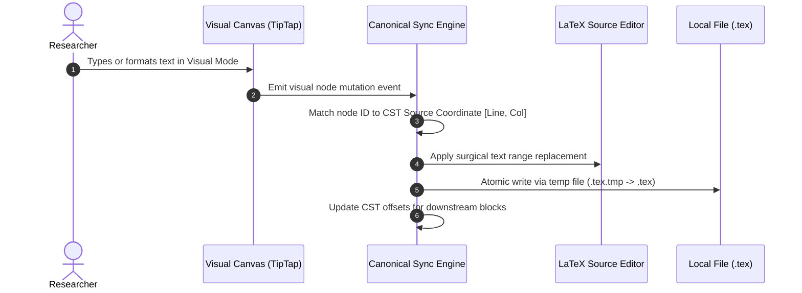
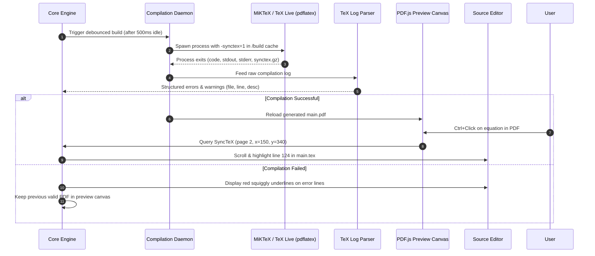
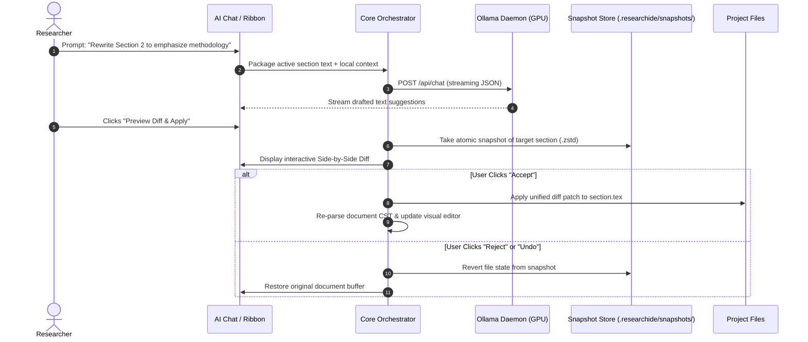
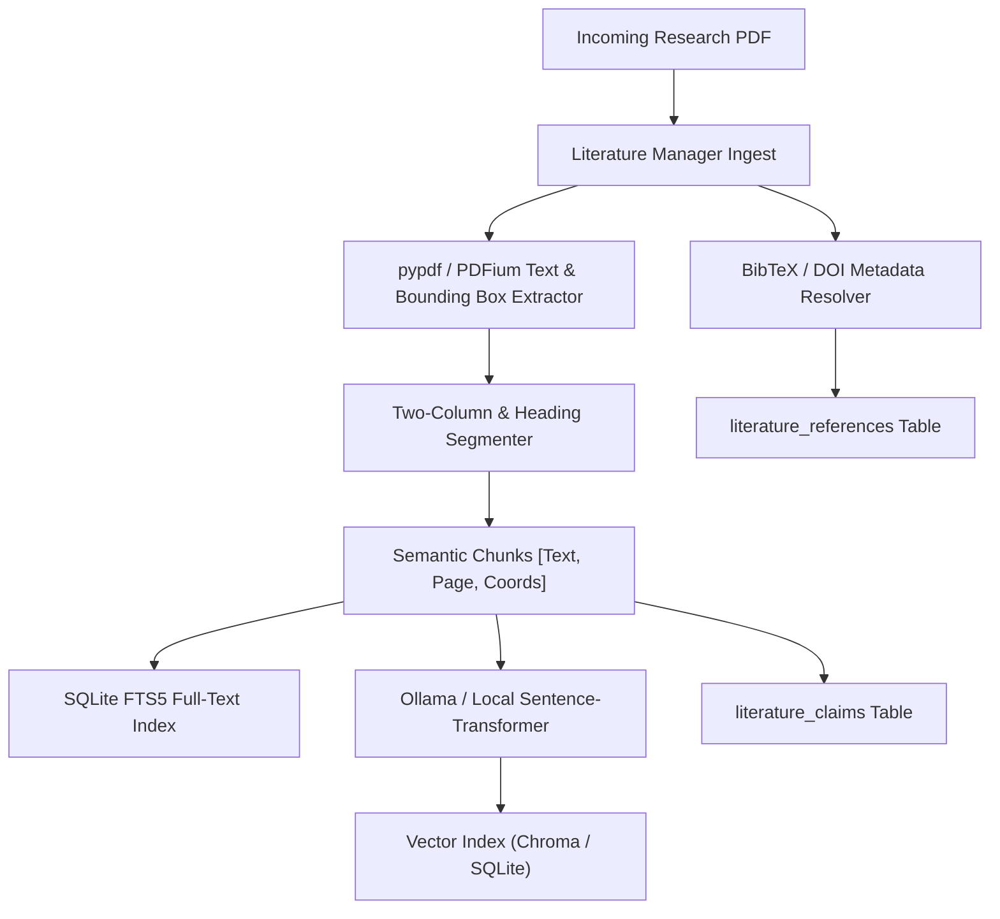

# DATA FLOW DIAGRAMS
## ResearchIDE: Document Sync, Compilation, AI and Literature Pipelines
**Document Version:** 1.0.0  

---

## 1. Document Editing and Synchronization Data Flow

---

## 2. LaTeX Compilation and SyncTeX Feedback Loop

---

## 3. Local AI Generation and Pre-Mutation Rollback Flow

---

## 4. Literature Ingestion & Evidence Grounding Pipeline

