# MASTER DEVELOPMENT ROADMAP
## ResearchIDE: Phased Implementation and Milestone Verification
**Document Version:** 1.0.0  
**Framework:** Python 3.11+ / PySide6  
**Status:** Phase 0 Active  

---

## 1. Development Phasing Overview

```mermaid
flowchart LR
    P0["Phase 0: Architecture & Foundation"] --> P1["Phase 1: PySide6 App Foundation"]
    P1 --> P2["Phase 2: LaTeX Engine & PDF Preview"]
    P2 --> P3["Phase 3: Visual Editor & Sync"]
    P3 --> P4["Phase 4: Local AI Assistant (Ollama)"]
    P4 --> P5["Phase 5: Research Intelligence & Library"]
    P5 --> P6["Phase 6: Templates & Publication Prep"]
    P6 --> P7["Phase 7: Reliability & Windows Release"]
```

---

## 2. Detailed Phase Breakdown

### Phase 0: System Architecture & Technical Foundation
- **Objectives:** Establish project architecture, database schemas, technical decisions, dependency register, document synchronization design, and build a standalone Python prototype validating lossless LaTeX round-tripping and source position mapping.
- **Deliverables:** Architectural specifications, database designs, dependency register, document sync design, automated test suite, and working Python prototype.
- **Acceptance Criteria:** 100% round-trip fidelity on supported constructs, graceful isolation of unsupported LaTeX macros, and passing prototype unit tests.

### Phase 1: Application Foundation (PySide6)
- **Objectives:** Implement the desktop application foundation using PySide6.
- **Deliverables:** Main window, Office-style ribbon, project explorer, dockable workspace, SQLite project database implementation, settings manager, and safe local file operations.
- **Acceptance Criteria:** Application launches cleanly on Windows 10/11; projects can be created, saved, reopened, and deleted; settings persist in SQLite.

### Phase 2: LaTeX Editor, Compiler and PDF Preview
- **Objectives:** Build the complete local LaTeX editing and compilation toolchain.
- **Deliverables:** LaTeX code editor with syntax highlighting and code folding; compiler manager auto-detecting MiKTeX / TeX Live (PDFLaTeX, XeLaTeX, LuaLaTeX); asynchronous build runner with error parsing; integrated high-DPI PDF preview; SyncTeX bidirectional navigation.
- **Acceptance Criteria:** User can edit `.tex` source, compile a document locally in < 2.0s, view the generated PDF, and navigate between source and PDF via SyncTeX.

### Phase 3: Visual Document Editor & Bidirectional Synchronization
- **Objectives:** Implement the Word-style visual document editor and bidirectional synchronization with LaTeX source.
- **Deliverables:** TipTap/ProseMirror visual canvas embedded via QWebEngineView; bidirectional CST-driven synchronizer; visual insertion ribbons for tables, equations, citations, and figures; opaque code pills for custom macros.
- **Acceptance Criteria:** Visual edits patch raw LaTeX without corrupting unedited macros or comments; changes in LaTeX source update the visual editor.

### Phase 4: Local AI Engine & Academic Writing Assistant
- **Objectives:** Connect local Ollama inference to the academic writing workspace.
- **Deliverables:** Ollama detection and HTTP streaming client; single-model VRAM governor (Qwen-2.5-14B); command-based natural language assistant; project-bounded contextual retrieval; AI suggestion preview/diff interface with mandatory user approval.
- **Acceptance Criteria:** Zero cloud API calls; AI generates academic drafts and explains LaTeX errors; user can accept/reject diffs; memory stays within 10 GB VRAM limit.

### Phase 5: Research Intelligence & Literature Management
- **Objectives:** Implement local research PDF extraction, reference management, and claim traceability.
- **Deliverables:** PDF library with drag-and-drop ingestion; layout-aware text/metadata extraction; reference manager (BibTeX/RIS import/export, citation auto-complete); grounded claim-to-source traceability linking claims to exact PDF pages.
- **Acceptance Criteria:** Ingested papers are indexed in SQLite FTS5; citations in manuscripts link to verified local papers; zero hallucinated citations.

### Phase 6: Academic Templates & Publication Preparation
- **Objectives:** Build publication template support and submission compliance verification.
- **Deliverables:** Built-in template profiles (IEEE, Springer, Elsevier, ACM); formatting compliance auditor (margins, word counts, required sections); submission bundle packager (compiled PDF + LaTeX source + assets).
- **Acceptance Criteria:** Switching templates preserves all manuscript content, citations, and figures; compliance report highlights formatting violations.

### Phase 7: Reliability, Performance and Windows Release
- **Objectives:** Prepare the application for stable everyday offline use and produce the Windows installer.
- **Deliverables:** Automated autosave and pre-mutation rollback; document revision history; structured diagnostics; fully offline verification test suite; standard Windows installer (.exe / .msi) via PyInstaller.
- **Acceptance Criteria:** Complete workflow operates 100% offline with network disabled; zero crashes under stress; installer configures application cleanly.

