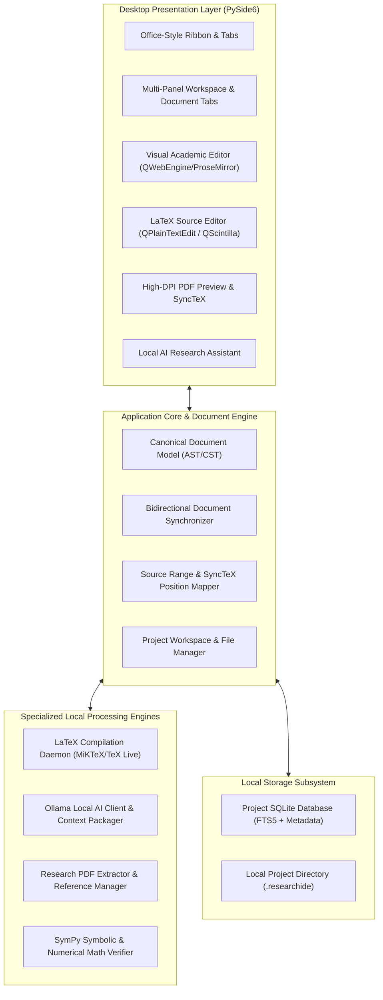

# PROJECT MASTER DOCUMENT
## ResearchIDE: Offline AI-Powered Academic Research & LaTeX Environment
**Document Version:** 1.0.0  
**Last Updated:** 6 November 2026  
**Primary Language:** Python 3.11+  
**GUI Framework:** PySide6 (Qt for Python)  
**Target Platform:** Windows 10/11 (Local-First, Offline-First)  
**Target Hardware:** AMD Ryzen 5 5600G (6C/12T) | NVIDIA GeForce RTX 3060 12GB | 16 GB RAM | 1 TB NVMe SSD  

---

## 1. Project Overview & Vision

ResearchIDE is a comprehensive, local-first academic research environment and scientific writing platform designed specifically for Windows workstations. It bridges the gap between Microsoft Word-style visual document editing and professional LaTeX source authoring, augmented with local AI intelligence, mathematical symbolic verification, academic literature analysis, and offline publication preparation.

### 1.1 Core Value Proposition
- **Unified Academic Workflow:** Eliminates tool fragmentation by integrating rich visual writing, raw LaTeX compilation, PDF preview with SyncTeX, local reference management, and AI research assistance in a single window.
- **Strict Data Sovereignty & Offline Independence:** 100% of core operations (editing, compilation, local LLM inference, vector search, and citation analysis) execute entirely on the user's workstation without sending any data to cloud services.
- **Document Source Preservation:** A non-destructive dual-representation engine guarantees that arbitrary LaTeX macros, preamble configurations, custom environments, and BibTeX databases are preserved byte-for-byte without silent corruption.

---

## 2. Fixed Architectural Foundations

As established in `prompts/MASTER_INSTRUCTIONS.md`:
1. **Operating System:** Windows 10/11 64-bit.
2. **Primary Programming Language:** Python 3.11+ with strict type hints (`typing`, `dataclasses`, `pydantic`).
3. **Desktop GUI Framework:** PySide6 (Qt 6.7+ for Python) leveraging native desktop widgets, high-DPI scaling, QWebEngineView for rich document canvas and PDF rendering, and Qt styling.
4. **Local AI Inference Engine:** Ollama running locally (`http://127.0.0.1:11434`) targeting quantized open models (e.g., `Qwen2.5-14B-Instruct-Q4_K_M` or `Llama-3.1-8B-Instruct`).
5. **Relational & Search Storage:** SQLite 3 in WAL mode, incorporating FTS5 full-text indexing and vector search.
6. **LaTeX Toolchain:** Local MiKTeX or TeX Live distribution (`pdflatex`, `xelatex`, `lualatex`, `bibtex`, `biber`, `synctex`).
7. **Packaging & Distribution:** Standard Windows executable / installer created via PyInstaller and Inno Setup / WiX.

---

## 3. High-Level Subsystem Breakdown

---

## 4. Hardware Optimization Policies (RTX 3060 12GB + 16GB RAM)

- **Single Resident Model Policy:** Only one LLM is loaded into VRAM at any time. Specialist personas are implemented via system prompts and structured tool schemas rather than concurrent model loading.
- **VRAM Headroom Guard:** Maximum working VRAM allocated to Ollama is capped at 9.5 GB, preserving 2.5 GB for Windows DWM, display buffers, and Qt hardware acceleration.
- **Host Memory Throttling:** Background ingestion, PDF OCR, and vector embedding generation are strictly throttled to single-thread worker pools to prevent Windows paging file thrashing.

---

## 5. Development Governance

Development is strictly phased according to `prompts/` specifications:
- **Phase 0:** System Architecture & Technical Foundation *(Current)*
- **Phase 1:** Application Foundation & PySide6 Workspace
- **Phase 2:** LaTeX Source Editor, Compiler, and PDF Preview
- **Phase 3:** Visual Document Editor & Bidirectional Synchronization
- **Phase 4:** Local AI Engine & Academic Writing Assistant
- **Phase 5:** Research Intelligence & Literature Management
- **Phase 6:** Academic Templates & Publication Preparation
- **Phase 7:** Reliability, Performance, and Windows Release

