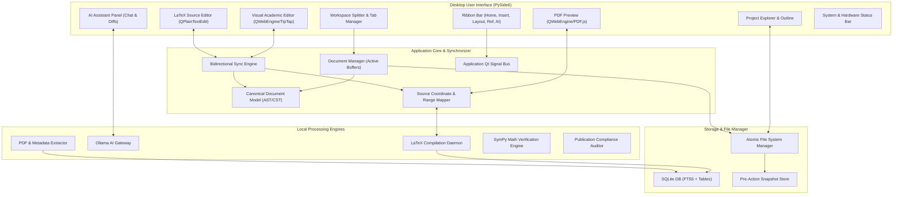

# SYSTEM COMPONENT DIAGRAM
## ResearchIDE: Modular Component Breakdown and Interfaces
**Document Version:** 1.0.0  

---

## 1. High-Level Subsystem Architecture

---

## 2. Component Interface Specifications

### 2.1 Visual Editor $\longleftrightarrow$ Core Synchronizer Interface
- **Signal `block_edited(block_id: str, new_content: dict)`:** Emitted by the visual editor when the user alters a paragraph, heading, or table cell.
- **Method `apply_visual_patch(block_id: str, patch_data: dict) -> RangePatch`:** Translates the visual node modification into a byte-exact range patch for the raw LaTeX buffer.
- **Signal `source_updated(updated_blocks: list[Block])`:** Pushes updated canonical blocks into the visual canvas when raw LaTeX edits occur.

### 2.2 LaTeX Source Editor $\longleftrightarrow$ Compiler Interface
- **Method `compile_document(project_path: Path, engine: str) -> QProcess`:** Spawns asynchronous compilation in a background thread.
- **Signal `compilation_finished(success: bool, pdf_path: Path, diagnostics: list[Diagnostic])`:** Delivers parsed errors/warnings and reloads the PDF viewer canvas.
- **Method `synctex_source_to_pdf(file: str, line: int, col: int) -> PDFCoordinate`:** Resolves click position in source to PDF page bounding box.

### 2.3 AI Assistant $\longleftrightarrow$ Core Document Interface
- **Method `request_ai_generation(prompt: str, context: ProjectContext) -> AsyncIterator[str]`:** Streams tokens from local Ollama directly to the UI.
- **Method `create_pre_mutation_snapshot(files: list[Path]) -> str`:** Generates atomic backup before any AI mutation can be committed.
- **Method `apply_suggestion_diff(target_file: Path, diff: str) -> bool`:** Applies user-approved diff atomically to disk and syncs buffers.

